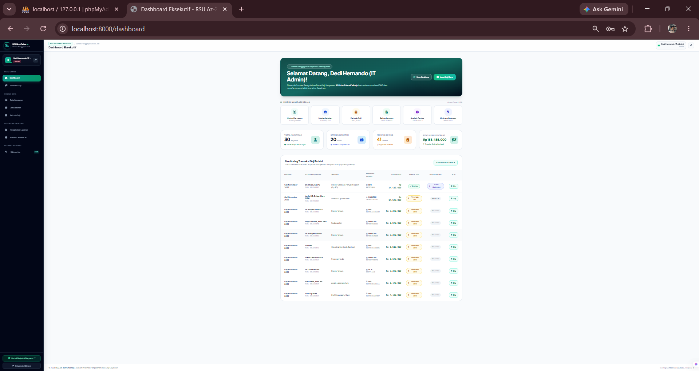
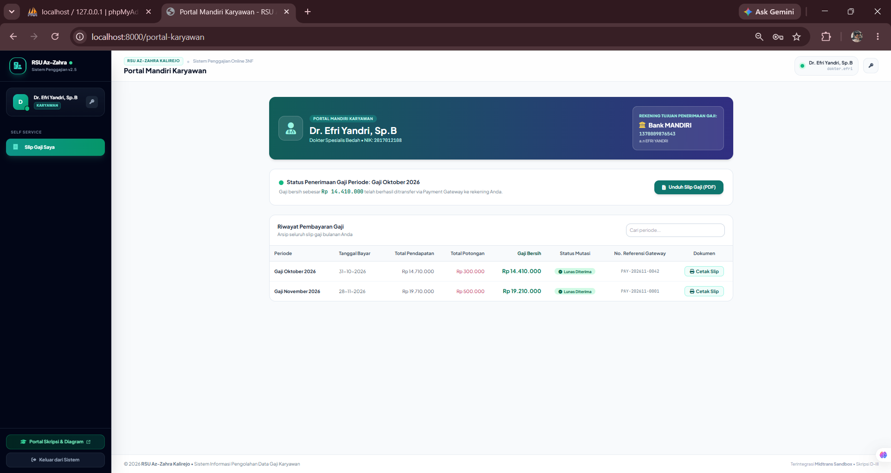

# 🏥 Sistem Informasi Pengolahan Data Gaji Karyawan RSU Az-Zahra Kalirejo Berbasis Web

[](https://laravel.com)
[](https://www.php.net)
[](https://www.mysql.com)
[](https://tailwindcss.com)
[](https://midtrans.com)
[](#)

> **Repositori Resmi Proyek Tugas Akhir / Skripsi D-III Sistem Informasi**  
> **Universitas Muhammadiyah Metro**  
> **Penyusun:** Sulung Yogi Prasetya (NPM: 14410041)  
> **Instansi Mitra:** Rumah Sakit Umum (RSU) Az-Zahra Kalirejo, Lampung Tengah  

---

## 📑 Daftar Isi
1. [Ringkasan Proyek](#-ringkasan-proyek)
2. [Fitur Utama Sistem](#-fitur-utama-sistem)
3. [Perancangan Sistem & Diagram](#-perancangan-sistem--diagram)
   - [1. Flowchart Aliran Sistem Informasi (ASI) Swimlane](#1-flowchart-aliran-sistem-informasi-asi-swimlane-4-jalur)
   - [2. Activity Flowchart Siklus Penggajian End-to-End](#2-activity-flowchart-siklus-penggajian-end-to-end)
   - [3. Data Flow Diagram (DFD) Level 0 / Konteks](#3-data-flow-diagram-dfd-level-0--diagram-konteks)
   - [4. Use Case Diagram UML (15 Use Case)](#4-use-case-diagram-uml-15-use-case)
   - [5. Entity Relationship Diagram (ERD) 3NF](#5-entity-relationship-diagram-erd-normalisasi-3nf)
4. [Tangkapan Layar Antarmuka Aplikasi (Screenshots)](#-tangkapan-layar-antarmuka-aplikasi-screenshots)
   - [1. Halaman Login Multi-Role](#1-halaman-login-multi-role)
   - [2. Panel Admin IT](#2-panel-admin-it-kelola-karyawan--jabatan)
   - [3. Panel Bendahara Keuangan](#3-panel-bendahara-keuangan-perhitungan-gaji--pencairan-online)
   - [4. Dashboard Eksekutif Direktur / Manager](#4-dashboard-eksekutif-direktur--manager-approval-gaji)
   - [5. Portal Mandiri Karyawan](#5-portal-mandiri-karyawan-transparansi--slip-gaji-pdf)
5. [Struktur Basis Data Normalisasi 3NF](#-struktur-basis-data-normalisasi-3nf)
6. [Panduan Instalasi & Menjalankan Proyek](#-panduan-instalasi--menjalankan-proyek)
7. [Akun Pengujian Demo (Credentials)](#-akun-pengujian-demo-credentials)
8. [Pengujian Black Box Testing](#-pengujian-black-box-testing)

---

## 📌 Ringkasan Proyek

Sistem Informasi Pengolahan Data Gaji Karyawan RSU Az-Zahra Kalirejo merupakan aplikasi berbasis web modern yang dibangun untuk mengatasi inefisiensi pencatatan manual penggajian karyawan medis dan non-medis. Sistem ini mengintegrasikan:
1. **Formula Penggajian Terstandarisasi 3NF**: Kalkulasi otomatis Gaji Pokok, Tunjangan Jabatan, Uang Makan Kehadiran, Jam Lembur, Insentif Tindakan Medis (Operasi OK & Laboratorium), serta potongan wajib (BPJS Kesehatan, BPJS Ketenagakerjaan, PPh 21, dan Potongan Pinjaman Rumah Sakit).
2. **Otorisasi Direktur Bertingkat**: Mekanisme verifikasi draf gaji oleh Bendahara sebelum disahkan secara resmi oleh Direktur Rumah Sakit via tombol approval AJAX.
3. **Disbursement Otomatis Payment Gateway (Midtrans Iris API)**: Penyaluran transfer gaji bersih (*Take Home Pay*) langsung ke rekening bank masing-masing karyawan secara *real-time* dengan validasi nomor Virtual Account (VA) dan *idempotency reference number*.
4. **Portal Mandiri Karyawan (*Self-Service Employee Portal*)**: Transparansi rincian gaji, riwayat transfer, serta kemampuan mengunduh dan mencetak Slip Gaji Resmi digital berformat PDF standar rumah sakit.

---

## ⭐ Fitur Utama Sistem

| Modul Fungsional | Deskripsi Kemampuan Sistem | Aktor Pengguna |
| :--- | :--- | :--- |
| **Autentikasi Multi-Role** | Sistem login tunggal berbasis username atau NIK karyawan dengan enkripsi Bcrypt. Dilengkapi fitur ubah password mandiri. | Admin IT, Bendahara, Direktur, Karyawan |
| **Master Data Terpusat** | Pengelolaan data 30 staf (medis/non-medis), tarif master jabatan, rekening bank payroll, dan masa kerja. | Admin IT |
| **Periode Penggajian** | Pembukaan periode baru bulanan, penguncian status (*Buka*, *Draf*, *Disetujui*, *Selesai*). | Bendahara |
| **Kalkulasi & Batch Generator** | Generate massal draf gaji 30 karyawan dalam 1 klik, penyesuaian kehadiran, jam lembur, tindakan OK dan Lab. | Bendahara |
| **Approval / Otorisasi Eksekutif** | Tinjauan draf finansial, ringkasan pengeluaran rumah sakit, hak veto persetujuan (*ACC*) atau pengembalian revisi. | Direktur / Manager |
| **Disbursement Online (Midtrans)** | Eksekusi pencairan dana online via API Midtrans Sandbox BRI VA, update otomatis status LUNAS dan nomor referensi payout. | Bendahara & Sistem API |
| **Portal Slip Gaji Mandiri** | Karyawan login melihat rincian gaji bersih, status transfer bank payroll, dan cetak slip gaji format A4 resmi. | Karyawan / Dokter |
| **Rekapitulasi & Pelaporan** | Cetak rekap bulanan tanda tangan basah pimpinan, export CSV Microsoft Excel, dan cetak resi bukti transfer bank. | Bendahara & Direktur |

---

## 📊 Perancangan Sistem & Diagram

Semua diagram dirancang dengan standar akademis D-III Sistem Informasi, beresolusi tinggi (300 DPI), serta bebas tumpang tindih (*zero overflow & zero text clipping*). File original tersedia pada folder `diagram_images` / `diagram images`.

### 1. Flowchart Aliran Sistem Informasi (ASI) Swimlane 4 Jalur
Diagram ini memetakan pemisahan wewenang (*Separation of Duties*) antara **Karyawan/Dokter**, **Bendahara Keuangan**, **Direktur Rumah Sakit**, dan **Payment Gateway Midtrans**.

<p align="center">
  
</p>
<p align="center"><em>Gambar 1: Aliran Sistem Informasi (ASI) Swimlane 4 Jalur Wewenang</em></p>

---

### 2. Activity Flowchart Siklus Penggajian End-to-End
Diagram alur aktivitas logika sistem dari pembukaan periode baru, input presensi & tindakan, eksekusi kalkulasi formula 3NF, otorisasi Direktur, integrasi transfer Midtrans, hingga penerbitan slip gaji.

<p align="center">
  
</p>
<p align="center"><em>Gambar 2: Activity Flowchart Logika Penggajian End-to-End</em></p>

---

### 3. Data Flow Diagram (DFD) Level 0 / Diagram Konteks
Memodelkan aliran data masukan dan keluaran antara 4 entitas eksternal (*Admin IT*, *Bendahara*, *Direktur*, *Karyawan*, serta *Midtrans API*) dengan Sistem Penggajian Online.

<p align="center">
  
</p>
<p align="center"><em>Gambar 3: Data Flow Diagram (DFD) Level 0 / Diagram Konteks</em></p>

---

### 4. Use Case Diagram UML (15 Use Case)
Memetakan 15 fungsionalitas utama sistem ke dalam 4 modul utama (Autentikasi, Master Data, Kalkulasi & Approval, serta Disbursement Online).

<p align="center">
  
</p>
<p align="center"><em>Gambar 4: Use Case Diagram UML Sistem Penggajian RSU Az-Zahra</em></p>

---

### 5. Entity Relationship Diagram (ERD) Normalisasi 3NF
Rancangan basis data relasional 3NF yang menghubungkan 7 tabel utama tanpa anomali data (*insertion*, *update*, atau *deletion anomaly*).

<p align="center">
  
</p>
<p align="center"><em>Gambar 5: Entity Relationship Diagram (ERD) Normalisasi 3NF Terelasi</em></p>

---

## 🖥️ Tangkapan Layar Antarmuka Aplikasi (Screenshots)

Berikut adalah dokumentasi antarmuka aplikasi yang telah berjalan secara langsung (*live system*). Gambar tersimpan di folder `SS`.

### 1. Halaman Login Multi-Role
Halaman autentikasi gerbang tunggal dengan validasi username/NIK dan password terenkripsi, dilengkapi tombol pintas demo role untuk mempermudah evaluasi pengujian.

<p align="center">
  
</p>
<p align="center"><em>Gambar 6: Tampilan Halaman Login Multi-Role Aplikasi</em></p>

---

### 2. Panel Admin IT (Kelola Karyawan & Jabatan)
Dashboard khusus Administrator untuk manajemen data master 30 pegawai, pengaturan tarif jabatan medis/non-medis, dan manajemen akun pengguna.

<p align="center">
  
</p>
<p align="center"><em>Gambar 7: Tampilan Dashboard & Manajemen Staf oleh Admin IT</em></p>

---

### 3. Panel Bendahara Keuangan (Perhitungan Gaji & Pencairan Online)
Panel Bagian Keuangan untuk kalkulasi gaji massal (*batch*), input jam lembur & insentif tindakan operasi, pengajuan draf ke Direktur, dan eksekusi pencairan gaji online via Midtrans API.

<p align="center">
  
</p>
<p align="center"><em>Gambar 8: Tampilan Pengolahan Data Transaksi Penggajian oleh Bendahara</em></p>

---

### 4. Dashboard Eksekutif Direktur / Manager (Approval Gaji)
Dashboard Pimpinan Rumah Sakit untuk meninjau ringkasan anggaran belanja pegawai, grafik distribusi gaji per divisi, serta tombol pengesahan otorisasi (*ACC*) sebelum gaji dicairkan.

<p align="center">
  
</p>
<p align="center"><em>Gambar 9: Tampilan Dashboard Eksekutif dan Tombol Approval Direktur</em></p>

---

### 5. Portal Mandiri Karyawan (Transparansi & Slip Gaji PDF)
Portal khusus karyawan dan dokter untuk memantau status pembayaran gaji secara transparan, melihat nomor rekening payroll, dan mengunduh Slip Gaji Digital berformat resmi rumah sakit.

<p align="center">
  
</p>
<p align="center"><em>Gambar 10: Tampilan Portal Mandiri Karyawan & Bukti Penerimaan Gaji</em></p>

---

## 🗄️ Struktur Basis Data Normalisasi 3NF

Basis data dirancang dengan mematuhi kaidah **Bentuk Normal Ketiga (3NF)**:
1. **1NF**: Setiap atribut bersifat atomik dan tidak terdapat grup data berulang.
2. **2NF**: Seluruh atribut non-kunci bergantung penuh pada Primary Key (*no partial dependency*).
3. **3NF**: Tidak ada ketergantungan transitif antar atribut non-kunci (*no transitive dependency*).

```
tb_jabatan (id_jabatan, nama_jabatan, divisi, gaji_pokok, tunjangan_jabatan, uang_makan_per_hari, tarif_lembur_per_jam)
    └── 1:N ──> tb_karyawan (nik, id_jabatan, nama_karyawan, jenis_kelamin, status_karyawan, no_rekening, nama_bank, status_aktif)
                    ├── 1:1 ──> tb_user (id_user, nik, username, password, nama_lengkap, role)
                    └── 1:N ──> tb_gaji (id_gaji, id_periode, nik, hari_hadir, jam_lembur, insentif_tindakan, bpjs, pph21, potongan_lain, total_gaji_bersih, status_approval, status_bayar)
                                    ├── N:1 ──> tb_periode_gaji (id_periode, nama_periode, bulan, tahun, tanggal_mulai, tanggal_selesai, status)
                                    └── 1:1 ──> tb_disbursement (id_disbursement, id_gaji, transaction_id, reference_no, va_number, status_transaksi)

tb_pengaturan_gateway (id, payment_gateway, server_key, client_key, merchant_id, is_production, is_active)
```

---

## 🚀 Panduan Instalasi & Menjalankan Proyek

### Prasyarat Perangkat Lunak
- **PHP**: Versi `8.2` atau lebih baru (dengan ekstensi `pdo_mysql`, `openssl`, `mbstring`, `curl`)
- **Composer**: Versi `2.x`
- **Database Server**: MySQL / MariaDB (XAMPP v3.3+)
- **Web Browser**: Google Chrome / Microsoft Edge / Mozilla Firefox

### Langkah-Langkah Menjalankan Aplikasi

1. **Clone Repositori**:
   ```bash
   git clone https://github.com/anangaja1616-star/UTS-RSU-AZZAHRA.git
   cd UTS-RSU-AZZAHRA
   ```

2. **Masuk ke Direktori Laravel**:
   ```bash
   cd laravel-penggajian
   ```

3. **Install Dependensi Composer**:
   ```bash
   composer install
   ```

4. **Konfigurasi Environment (`.env`)**:
   Salin `.env.example` menjadi `.env`:
   ```bash
   cp .env.example .env
   php artisan key:generate
   ```
   Pastikan konfigurasi database sesuai dengan pengaturan MySQL lokal Anda:
   ```env
   DB_CONNECTION=mysql
   DB_HOST=127.0.0.1
   DB_PORT=3306
   DB_DATABASE=db_penggajian_azzahra
   DB_USERNAME=root
   DB_PASSWORD=
   ```

5. **Impor Skema & Data Dummy Database**:
   Jalankan file SQL skema dan dummy data yang telah disediakan di root proyek ke dalam database `db_penggajian_azzahra`:
   ```bash
   # Melalui terminal MySQL atau phpMyAdmin:
   mysql -u root db_penggajian_azzahra < ../database_schema_3nf.sql
   mysql -u root db_penggajian_azzahra < ../seed_dummy_lengkap.sql
   ```

6. **Jalankan Server Development Laravel**:
   ```bash
   php artisan serve --host=127.0.0.1 --port=8000
   ```
   *Atau klik ganda file pintasan:* `START_SERVER.bat` pada folder proyek.

7. **Akses Aplikasi**:
   - **Aplikasi Web**: [http://localhost:8000](http://localhost:8000)
   - **Portal Skripsi & Diagram Interaktif**: [http://localhost:8000/portal](http://localhost:8000/portal)
   - **Laporan Lengkap Skripsi**: [http://localhost:8000/laporan-skripsi](http://localhost:8000/laporan-skripsi)

---

## 🔑 Akun Pengujian Demo (Credentials)

Untuk memudahkan evaluasi pengujian fitur berdasarkan hak akses (*Role-Based Access Control*), gunakan akun demo berikut:

| Peran (Role) | Username | Password | Deskripsi Wewenang Akun |
| :--- | :--- | :--- | :--- |
| **Admin IT** | `admin` | `password` | Kelola data 30 staf, master tarif jabatan, dan kredensial sistem |
| **Bendahara** | `bendahara` | `password` | Buka periode, kalkulasi batch gaji, ajukan ACC, pencairan Midtrans |
| **Direktur / Manager** | `manager` | `password` | Tinjau draf finansial rumah sakit, persetujuan otorisasi (*ACC*) |
| **Karyawan / Dokter** | `dokter.efri` | `password` | Cek status gaji masuk rekening bank, unduh & cetak Slip Gaji PDF |
| **Karyawan Paramedis**| `2017021204` | `password` | Login menggunakan NIK karyawan, melihat transparansi gaji |

---

## 🧪 Pengujian Black Box Testing

Pengujian dilakukan menggunakan metode **Black Box Testing** pada 12 skenario fungsional utama:

| No | Skenario Pengujian | Masukan (Input) | Hasil yang Diharapkan | Status |
| :-: | :--- | :--- | :--- | :-: |
| 1 | Autentikasi Login Multi-Role | Input username & password 4 role | Masuk ke dashboard sesuai hak akses masing-masing | **Valid (100%)** |
| 2 | Proteksi Akses & Password | Input password salah & URL unauthorized | Akses ditolak dan dialihkan ke form login | **Valid (100%)** |
| 3 | CRUD Master Karyawan | Tambah staf baru dengan rekening bank | Data tersimpan rapi pada `tb_karyawan` & `tb_user` | **Valid (100%)** |
| 4 | Buka Periode Penggajian | Pilih bulan & tahun periode baru | Periode aktif terbit dan siap menerima kalkulasi | **Valid (100%)** |
| 5 | Generate Gaji Massal 30 Staf | Klik tombol *Generate Batch* | Seluruh data 30 staf terhitung otomatis berstatus *Draft* | **Valid (100%)** |
| 6 | Akurasi Formula 3NF | Uji kalkulasi lembur & insentif medis | Nilai *Take Home Pay* akurat hingga rupiah terkecil | **Valid (100%)** |
| 7 | Otorisasi / Approval Direktur | Klik tombol *Setujui ACC* via AJAX | Status berubah menjadi *Disetujui* tanpa reload laman | **Valid (100%)** |
| 8 | Proteksi Pencairan Sebelum ACC | Klik cairkan saat status masih *Draft* | Sistem menolak pencairan hingga disetujui Direktur | **Valid (100%)** |
| 9 | Integrasi Payout Midtrans | Klik tombol *Cairkan Online (API)* | Menerima respon HTTP 201, nomor referensi payout & VA | **Valid (100%)** |
| 10 | Cetak Bukti Resi Transfer | Buka resi transaksi disbursement | Tampil struk resmi bank payout berstatus *LUNAS* | **Valid (100%)** |
| 11 | Portal Mandiri & Slip PDF | Karyawan login & unduh slip gaji | Tampil dokumen Slip Gaji A4 resmi lengkap kop RSU | **Valid (100%)** |
| 12 | Export Rekapitulasi Excel CSV | Klik tombol *Export CSV* | File CSV terunduh memuat rekapitulasi 30 staf | **Valid (100%)** |

---

## 👨‍🎓 Profil Penyusun

- **Nama Mahasiswa:** Sulung Yogi Prasetya  
- **NPM:** 14410041  
- **Program Studi:** D-III Sistem Informasi  
- **Perguruan Tinggi:** Universitas Muhammadiyah Metro  
- **Tahun Akademik:** 2026 / 2027  
- **Instansi Penelitian:** Rumah Sakit Umum (RSU) Az-Zahra Kalirejo, Kab. Lampung Tengah  

---

<p align="center">
  <b>© 2026 Sulung Yogi Prasetya (NPM: 14410041) - D-III Sistem Informasi UM Metro</b><br>
  <i>Sistem Informasi Pengolahan Data Gaji Karyawan RSU Az-Zahra Kalirejo</i>
</p>

