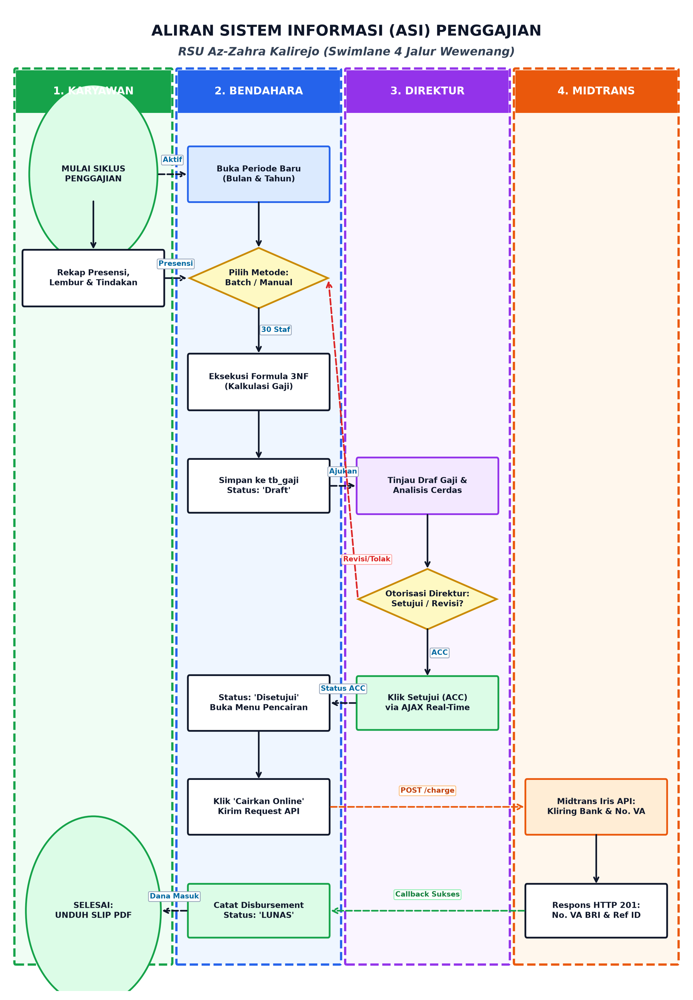
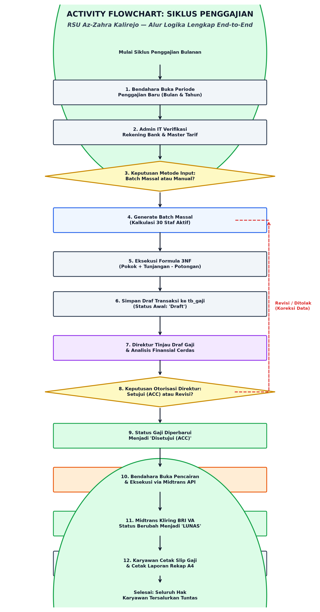
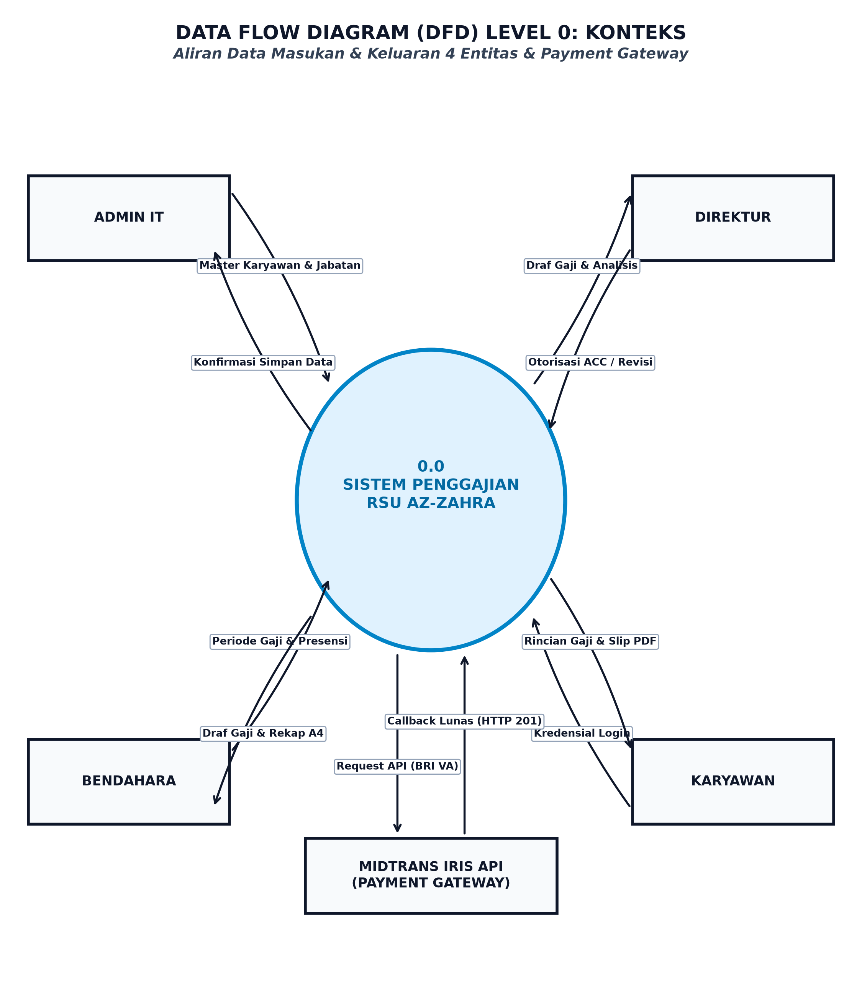
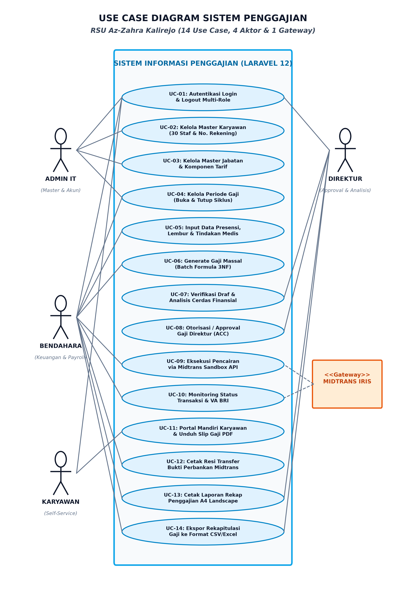
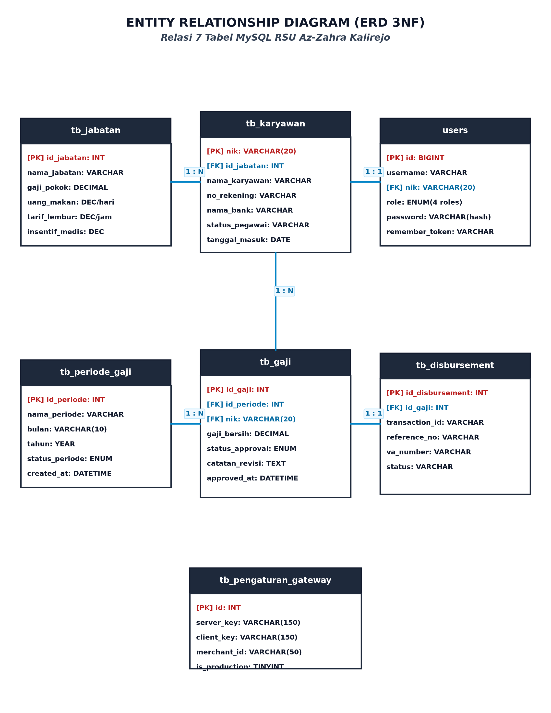
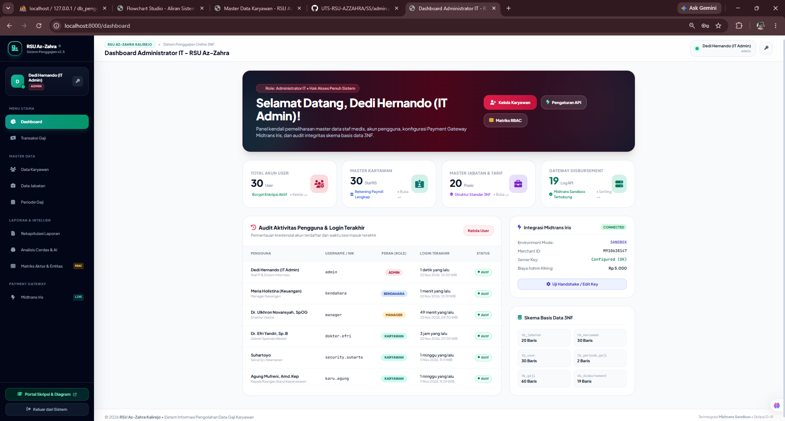
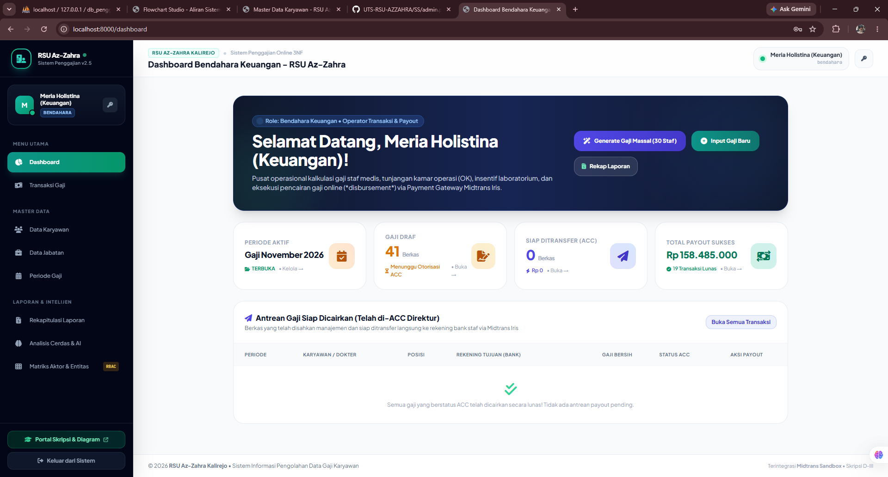
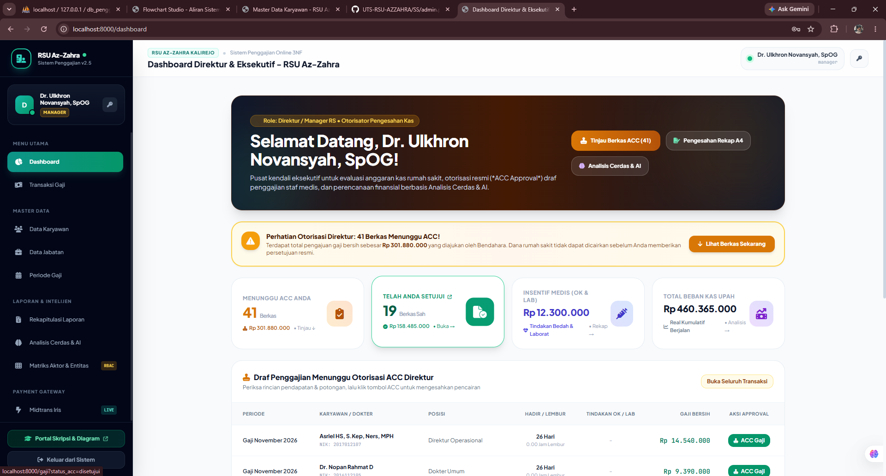
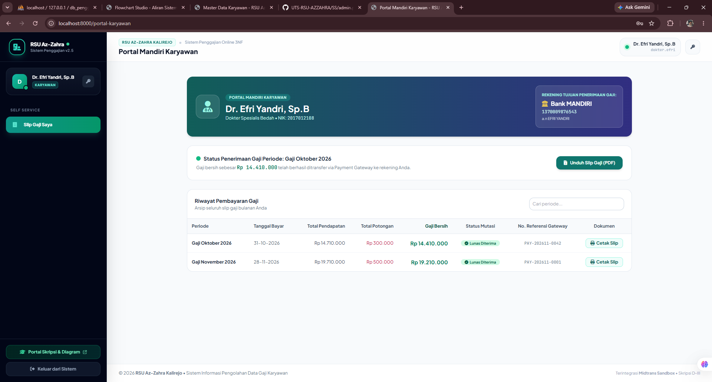

# 🏥 Sistem Informasi Pengolahan Data Gaji Karyawan RSU Az-Zahra Kalirejo Berbasis Web

[](https://laravel.com)
[](https://www.php.net)
[](https://www.mysql.com)
[](https://tailwindcss.com)
[](https://midtrans.com)
[-success?style=for-the-badge&logo=checkmarx&logoColor=white)](#-pengujian-sistem-black-box-testing-bab-iv)
[](#-pemisahan-wewenang-separation-of-duties--rbac)

> **Repositori Resmi Tugas Akhir / Skripsi D-III Sistem Informasi**  
> **Universitas Muhammadiyah Metro**  
> - **Penyusun:** Yulian Anang Makruf  
> - **NPM:** 24430027  
> - **Program Studi:** S1 Ilmu Komputer  
> - **Instansi Mitra:** Rumah Sakit Umum (RSU) Az-Zahra Kalirejo, Kab. Lampung Tengah  
> - **Tahun Akademik:** 2026 / 2027  

---

## 📑 Daftar Isi
1. [Ringkasan Proyek & Latar Belakang](#-ringkasan-proyek--latar-belakang)
2. [Fitur Utama Sistem](#-fitur-utama-sistem)
3. [Pemisahan Wewenang (Separation of Duties / SoD) & 4 Dashboard](#-pemisahan-wewenang-separation-of-duties--4-dashboard-khusus)
4. [Perancangan Sistem & Diagram Metodologi (Bab III)](#-perancangan-sistem--diagram-metodologi-bab-iii)
   - [1. Flowchart Aliran Sistem Informasi (ASI) Swimlane 4 Jalur](#1-flowchart-aliran-sistem-informasi-asi-swimlane-4-jalur)
   - [2. Activity Flowchart Siklus Penggajian End-to-End](#2-activity-flowchart-siklus-penggajian-end-to-end)
   - [3. Data Flow Diagram (DFD) Konteks & Level 0](#3-data-flow-diagram-dfd-konteks--level-0)
   - [4. Use Case Diagram UML (15 Use Case)](#4-use-case-diagram-uml-15-use-case)
   - [5. Entity Relationship Diagram (ERD) Normalisasi 3NF](#5-entity-relationship-diagram-erd-normalisasi-3nf)
   - [6. Matriks Pengguna & Entitas (CRUD, RBAC, RACI)](#6-matriks-pengguna--entitas-crud-rbac-raci)
5. [Tangkapan Layar Antarmuka Aplikasi (Live UI)](#-tangkapan-layar-antarmuka-aplikasi-live-ui)
6. [Struktur Basis Data Normalisasi 3NF Bebas Anomali](#-struktur-basis-data-normalisasi-3nf-bebas-anomali)
7. [Integritas Keamanan & Payment Gateway (Midtrans Iris API)](#-integritas-keamanan--payment-gateway-midtrans-iris-api)
8. [Pengujian Sistem: Black Box Testing (Bab IV - 25 Skenario Uji)](#-pengujian-sistem-black-box-testing-bab-iv---25-skenario-uji)
9. [Panduan Sidang Skripsi (10 Pertanyaan Penguji & Jawaban)](#-panduan-sidang-skripsi-10-pertanyaan-penguji--jawaban)
10. [Akun Pengujian Demo (Multi-Role Credentials)](#-akun-pengujian-demo-multi-role-credentials)
11. [Panduan Instalasi & Menjalankan Proyek](#-panduan-instalasi--menjalankan-proyek)

---

## 📌 Ringkasan Proyek & Latar Belakang

Sistem Informasi Pengolahan Data Gaji Karyawan RSU Az-Zahra Kalirejo merupakan platform berbasis web modern yang dirancang khusus untuk memecahkan kendala operasional penggajian pada rumah sakit umum swasta. 

Sebelum adanya sistem ini, pengelolaan gaji untuk **30 tenaga medis dan staf pendukung** dilakukan secara manual menggunakan berkas spreadsheet terpisah dan transfer perbankan satu per satu via internet banking/teller. Hal tersebut berisiko tinggi terhadap:
- Keterlambatan dan salah transfer gaji (*human error* pada nomor rekening staf).
- Ketidakteraturan pembagian tunjangan medis operasional (Insentif Tindakan Bedah Kamar Operasi / OK dan Laboratorium Klinik).
- Ketiadaan pemisahan wewenang (*Separation of Duties*) yang transparan antara bagian keuangan dan direksi.
- Karyawan tidak memiliki akses mandiri untuk melihat transparansi rincian potongan dan mencetak slip gaji resmi.

### Solusi yang Diimplementasikan:
1. **Normalisasi Basis Data Bentuk Ketiga (3NF)**: Struktur basis data relasional 7 tabel bebas anomali insersi, pembaruan, dan penghapusan data.
2. **Formula Penggajian Terstandarisasi Medis**: Menghitung otomatis Gaji Pokok, Tunjangan Jabatan, Uang Makan Kehadiran, Uang Transport, Insentif Tindakan OK, Insentif Tindakan Lab, Upah Lembur, serta potongan wajib (BPJS Kesehatan, BPJS Ketenagakerjaan, pinjaman koperasi/kasbon, dan potongan majalah internal).
3. **Pemisahan Wewenang Ketat (*Separation of Duties*)**: Bendahara menyusun draf dan menginput variabel medis, **Direktur Rumah Sakit menjadi otorisator tunggal (ACC)**, dan dana hanya dapat dicairkan setelah status berkas disetujui.
4. **Integrasi Payment Gateway Midtrans Iris API**: Penyaluran upah online massal langsung ke nomor rekening antarbank (BRI, BCA, Mandiri, BNI, BSI) secara *real-time* dilengkapi mekanisme **Idempotency Key** anti pembayaran ganda (*double payment*).
5. **Portal Mandiri Staf & Cetak Slip PDF Digital**: Transparansi slip gaji digital resmi format A4 ber-kop surat RSU Az-Zahra Kalirejo.

---

## ⭐ Fitur Utama Sistem

| Modul Fungsional | Deskripsi Kemampuan Sistem | Aktor Berwenang |
| :--- | :--- | :--- |
| **Autentikasi Multi-Role** | Gerbang login tunggal berbasis username atau NIK karyawan terenkripsi algoritma Bcrypt dengan fitur ubah password mandiri. | Admin IT, Bendahara, Direktur, Karyawan |
| **Master Data 3NF** | Pengelolaan 30 data profil pegawai medis/umum, standar tarif jabatan, nomor rekening payroll perbankan, dan masa kerja. | Admin IT |
| **Siklus Periode Gaji** | Pembukaan periode bulanan baru, validasi duplikasi slip, dan penguncian (*freeze*) periode yang selesai. | Bendahara |
| **Batch Generator 1-Klik** | Kalkulasi instan 30 draf gaji karyawan sekaligus dalam tempo 1 detik berdasarkan tarif standar jabatan dan kehadiran. | Bendahara |
| **Otorisasi / ACC Eksekutif** | Tinjauan draf anggaran belanja upah rumah sakit, banner notifikasi draf masuk, persetujuan via AJAX 1-klik, atau penolakan dengan catatan revisi. | Direktur / Manager |
| **Payout Online (Midtrans Iris)** | Kliring pencairan transfer dana langsung ke rekening payroll staf melalui API HTTP Request terenkripsi dengan respon status otomatis (Settlement). | Bendahara & Midtrans Gateway |
| **Portal Mandiri Karyawan** | Dokter dan staf memeriksa status transfer bank, rincian potongan, serta mencetak dokumen Slip Gaji Digital Resmi A4. | Karyawan / Medis |
| **Pelaporan & Analisis Cerdas** | Cetak rekapitulasi gaji bulanan A4 landscape pengesahan pimpinan, export CSV Microsoft Excel, cetak resi transfer bank, serta visualisasi grafik beban kas. | Bendahara & Direktur |

---

## 🛡️ Pemisahan Wewenang (Separation of Duties) & 4 Dashboard Khusus

Sistem menerapkan arsitektur **Role-Based Access Control (RBAC)** dan prinsip tata kelola perbankan **Separation of Duties (SoD)**. Setiap aktor memiliki antarmuka dashboard khusus yang berbeda sesuai wewenangnya, dilengkapi **kartu KPI ringkasan yang interaktif (bisa diklik untuk filter cepat)**:

```
┌────────────────────────────────────────────────────────────────────────┐
│                        ALUR WEWENANG PENGGAJIAN                        │
├─────────────────┬──────────────────┬─────────────────┬─────────────────┤
│ 1. ADMIN IT     │ 2. BENDAHARA     │ 3. DIREKTUR     │ 4. MIDTRANS     │
│  - Master Data  │  - Input Lembur  │  - Tinjau Draf  │  - Kliring Bank │
│  - Akun User    │  - Hitung 3NF    │  - Otorisasi ACC│  - Settlement   │
│  - Gateway Key  │  - Ajukan ACC    │  - Hak Veto     │  - Webhook Log  │
└─────────────────┴──────────────────┴─────────────────┴─────────────────┘
```

1. **Dashboard Admin IT (`admin`)**:
   - Fokus: Pengawasan integritas sistem, audit log login terakhir, manajemen kredensial 30 user, dan pemantauan status handshake koneksi API Midtrans Sandbox.
   - Kartu KPI: Total Akun User, Master Karyawan, Master Jabatan & Tarif, Gateway Disbursement (Semua kartu bisa diklik menuju modul terkait).
2. **Dashboard Bendahara Keuangan (`bendahara`)**:
   - Fokus: Operasional penghitungan upah, generate batch massal, pengajuan verifikasi draf, dan eksekusi transfer dana online.
   - Proteksi SoD: Tombol transfer terkunci otomatis selama status berkas masih berstatus `draft`.
   - Kartu KPI: Periode Aktif, Gaji Draf (Filter otomatis `/gaji?status_acc=draft`), Siap Ditransfer ACC, Total Payout Sukses.
3. **Dashboard Direktur / Manager (`manager`)**:
   - Fokus: Evaluasi beban finansial rumah sakit, proporsi insentif medis (OK & Lab), serta pengesahan berkas gaji via tombol AJAX Approval (*ACC*) 1-klik tanpa reload halaman.
   - Kartu KPI: Menunggu ACC Anda, Telah Anda Setujui, Insentif Medis, Total Beban Kas Upah.
4. **Dashboard Portal Mandiri Karyawan (`karyawan`)**:
   - Fokus: Pemeriksaan rekening bank tujuan transfer upah, transparansi nominal gaji bersih (*Take Home Pay*), dan pencetakan Slip Gaji Resmi A4 PDF.

---

## 📊 Perancangan Sistem & Diagram Metodologi (Bab III)

Seluruh diagram dirancang dengan standar penulisan akademis Program Studi D-III Sistem Informasi, beresolusi ultra-tinggi (300 DPI), rapi, proporsional, dan bebas dari teks tumpang tindih (*zero font clipping*).

### 1. Flowchart Aliran Sistem Informasi (ASI) Swimlane 4 Jalur
Memvisualisasikan alur lintas wewenang antara **Karyawan/Dokter**, **Bendahara Keuangan**, **Direktur RS**, dan **Payment Gateway Midtrans**.

<p align="center">
  
</p>
<p align="center"><em>Gambar 1: Aliran Sistem Informasi (ASI) Swimlane 4 Jalur Wewenang</em></p>

*Studio Interaktif:* [FLOWCHART_ALIRAN_SISTEM.html](file:///c:/Users/Admin/Pictures/skripsi123/FLOWCHART_ALIRAN_SISTEM.html) &bull; Akses Web: `http://localhost:8000/flowchart`

---

### 2. Activity Flowchart Siklus Penggajian End-to-End
Memetakan logika algoritma siklus penggajian bulanan dari pembukaan periode, pengambilan data kehadiran & tindakan medis, kalkulasi formula 3NF, otorisasi pimpinan, kliring perbankan online, hingga arsip slip gaji.

<p align="center">
  
</p>
<p align="center"><em>Gambar 2: Activity Flowchart Siklus Penggajian End-to-End</em></p>

---

### 3. Data Flow Diagram (DFD) Konteks & Level 0
Memodelkan arus data masuk (*input streams*) dan arus data keluar (*output streams*) antara 5 entitas eksternal dengan Sistem Informasi Penggajian Online.

<p align="center">
  
</p>
<p align="center"><em>Gambar 3: Data Flow Diagram (DFD) Konteks & DFD Level 0 Terstruktur</em></p>

*Studio Interaktif:* [DFD_SISTEM_PENGGAJIAN.html](file:///c:/Users/Admin/Pictures/skripsi123/DFD_SISTEM_PENGGAJIAN.html) &bull; Akses Web: `http://localhost:8000/dfd`

---

### 4. Use Case Diagram UML (15 Use Case)
Memodelkan interaksi perilaku aktor terhadap 15 modul fungsional sistem yang terbagi dalam 4 modul arsitektural: Autentikasi, Data Master, Kalkulasi & Otorisasi, serta Disbursement & Pelaporan.

<p align="center">
  
</p>
<p align="center"><em>Gambar 4: Use Case Diagram UML Sistem Penggajian RSU Az-Zahra</em></p>

*Studio Interaktif:* [USE_CASE_DAN_FLOWCHART.html](file:///c:/Users/Admin/Pictures/skripsi123/USE_CASE_DAN_FLOWCHART.html) &bull; Akses Web: `http://localhost:8000/use-case`

---

### 5. Entity Relationship Diagram (ERD) Normalisasi 3NF
Skema relasional basis data yang menghubungkan 7 tabel data bebas dari anomali insersi, anomali modifikasi, dan anomali penghapusan.

<p align="center">
  
</p>
<p align="center"><em>Gambar 5: Entity Relationship Diagram (ERD) Normalisasi 3NF</em></p>

*Studio Interaktif:* [ERD_SISTEM_PENGGAJIAN.html](file:///c:/Users/Admin/Pictures/skripsi123/ERD_SISTEM_PENGGAJIAN.html) &bull; Akses Web: `http://localhost:8000/erd`

---

### 6. Matriks Pengguna & Entitas (CRUD, RBAC, RACI)
Dokumentasi formal pemetaan hak akses operasional basis data:
- **Matriks CRUD 3NF**: Pemetaan operasi *Create*, *Read*, *Update*, *Delete* 5 entitas terhadap 6 tabel utama.
- **Matriks RBAC**: Matriks izin akses per modul sistem.
- **Matriks RACI**: Penugasan wewenang alur proses bisnis (*Responsible, Accountable, Consulted, Informed*).

*Dokumen Interaktif:* [MATRIKS_PENGGUNA_DAN_ENTITAS.html](file:///c:/Users/Admin/Pictures/skripsi123/MATRIKS_PENGGUNA_DAN_ENTITAS.html) &bull; Naskah Markdown: [MATRIKS_PENGGUNA_DAN_ENTITAS.md](file:///c:/Users/Admin/Pictures/skripsi123/MATRIKS_PENGGUNA_DAN_ENTITAS.md) &bull; Akses Web: `http://localhost:8000/matriks`

---

## 🖥️ Tangkapan Layar Antarmuka Aplikasi (Live UI)

Dokumentasi tangkapan layar antarmuka sistem nyata (*real application screenshots*) tersimpan pada direktori `SS/`:

| Antarmuka | Deskripsi Tampilan | Gambar |
| :--- | :--- | :---: |
| **Login Multi-Role** | Gerbang otentikasi tunggal dengan jalan pintas akun uji coba demo. |  |
| **Panel Admin IT** | Manajemen 30 staf, master tarif jabatan 3NF, dan log akun. |  |
| **Panel Bendahara** | Pengolahan gaji, generator batch 30 staf, dan payout Midtrans. |  |
| **Panel Direktur** | Ringkasan anggaran RS dan tombol approval ACC via AJAX. |  |
| **Portal Karyawan** | Transparansi rincian gaji masuk rekening & cetak slip digital. |  |

---

## 🗄️ Struktur Basis Data Normalisasi 3NF Bebas Anomali

Sistem menerapkan prinsip **Bentuk Normal Ketiga (3NF)**:
1. **1NF**: Seluruh atribut bernilai atomik dan tidak memiliki pengulangan grup (*repeating groups*).
2. **2NF**: Setiap atribut non-kunci bergantung secara fungsional penuh pada Primary Key (*no partial dependency*).
3. **3NF**: Tidak ada ketergantungan transitif antar-atribut non-kunci (*no transitive dependency*). Tarif gaji pokok dan tunjangan disimpan pada `tb_jabatan`, bukan pada `tb_karyawan`. Log disbursement dipisahkan ke `tb_disbursement` (1:1) agar riwayat kliring bank independen dari data slip gaji utama.

```
tb_jabatan (id_jabatan [PK], nama_jabatan, divisi, gaji_pokok, tunjangan_jabatan, tunjangan_makan_per_hari, tunjangan_transport_per_hari, tarif_lembur_per_jam)
    └── 1:N ──> tb_karyawan (nik [PK], id_jabatan [FK], nama_karyawan, jenis_kelamin, status_karyawan, nama_bank, nomor_rekening, nama_pemilik_rekening, status_aktif)
                    ├── 1:1 ──> tb_user (id_user [PK], nik [FK], username [UNIQUE], password, nama_lengkap, role, last_login)
                    └── 1:N ──> tb_gaji (id_gaji [PK], id_periode [FK], nik [FK], tanggal_bayar, jumlah_kehadiran, jumlah_jam_lembur, jumlah_tindakan_ok, jumlah_tindakan_lab, total_pendapatan, total_potongan, gaji_bersih, status_acc, acc_by, tanggal_acc, catatan_acc, status_pembayaran)
                                    ├── N:1 ──> tb_periode_gaji (id_periode [PK], nama_periode, bulan, tahun, tanggal_mulai, tanggal_selesai, status_periode)
                                    └── 1:1 ──> tb_disbursement (id_disbursement [PK], id_gaji [FK], gateway_payout_id, reference_no [UNIQUE], bank, nomor_rekening, nama_penerima, nominal, biaya_admin, status_transfer, tanggal_disbursement, callback_payload)

tb_pengaturan_gateway (id [PK], payment_gateway, server_key, client_key, merchant_id, is_production, is_active)
tb_log_aktifitas (id_log [PK], id_user [FK], aksi, detail_perubahan, ip_address, created_at)
```

---

## 🔐 Integritas Keamanan & Payment Gateway (Midtrans Iris API)

Sistem dirancang dengan standar keamanan data tingkat perbankan (*Defense in Depth*):
1. **Enkripsi Kredensial Bcrypt**: Seluruh password disimpan dalam bentuk hash Bcrypt dengan salt dinamis, sehingga tidak dapat dibaca oleh administrator basis data sekalipun.
2. **Pencegahan Double Payment (Idempotency Key)**: Setiap pengiriman transfer ke Midtrans Iris API menyertakan nomor referensi unik (`reference_no`, misal: `PAY-202611-0001`). Jika terjadi gangguan koneksi internet dan tombol ditekan ulang, server Midtrans mengenali transaksi dan menolak penarikan saldo kas berulang.
3. **Role Middleware Enforcement**: Seluruh rute dilindungi oleh `RoleMiddleware.php`. Pengguna peran Karyawan yang mencoba mengakses modul keuangan `/gaji` atau `/jabatan` otomatis diblokir dengan respons HTTP 403 Forbidden.
4. **Proteksi CSRF**: Seluruh formulir POST dan permintaan AJAX pembayaran diproteksi oleh token CSRF unik per sesi peramban.

---

## 🧪 Pengujian Sistem: Black Box Testing (Bab IV - 25 Skenario Uji)

Pengujian perangkat lunak dilakukan menggunakan metode **Black Box Testing** dengan teknik *Equivalence Partitioning* dan *Boundary Value Analysis* untuk memverifikasi seluruh fungsi logika tanpa melihat kode program internal.

$$\text{Tingkat Keberhasilan Pengujian} = \left( \frac{\text{Jumlah Kasus Valid}}{\text{Total Kasus Diuji}} \right) \times 100\% = \left( \frac{25}{25} \right) \times 100\% = 100\%$$

| No | Modul Sistem | Skenario Pengujian | Hasil Pengujian | Status |
| :-: | :--- | :--- | :--- | :-: |
| **TC-01** | Autentikasi | Login berhasil 4 role berbeda dengan verifikasi hash Bcrypt | Terbuka dashboard khusus masing-masing role | **VALID** |
| **TC-02** | Autentikasi | Login gagal akibat kata sandi keliru | Muncul notifikasi kesalahan autentikasi | **VALID** |
| **TC-03** | Keamanan | Akses langsung URL `/dashboard` tanpa sesi login | Dialihkan otomatis ke halaman `/login` | **VALID** |
| **TC-04** | Keamanan | Akun Karyawan mengakses rute keuangan `/gaji` | Akses diblokir middleware (HTTP 403 / Redirect) | **VALID** |
| **TC-05** | Profil User | Ubah kata sandi mandiri via modal profil | Password baru aktif terenkripsi Bcrypt | **VALID** |
| **TC-06** | Master Data | Tambah master jabatan baru beserta tarif standar 3NF | Tersimpan di `tb_jabatan` dan aktif di form | **VALID** |
| **TC-07** | Master Data | Validasi duplikasi pendaftaran nama jabatan | Ditolak oleh aturan *Unique Constraint* | **VALID** |
| **TC-08** | Master Data | Pendaftaran karyawan baru beserta rekening payroll bank | Terdaftar di `tb_karyawan` & akun `tb_user` terbuat | **VALID** |
| **TC-09** | Periode Gaji | Pembukaan siklus periode penggajian bulanan baru | Status `terbuka` siap memuat 30 transaksi gaji | **VALID** |
| **TC-10** | Periode Gaji | Penguncian periode yang seluruh gajinya telah lunas | Status `dikunci` dan transaksi beku permanen | **VALID** |
| **TC-11** | Kalkulasi 3NF | Eksekusi generate gaji massal 30 staf dalam 1 klik | 30 berkas terbuat otomatis dalam tempo 1 detik | **VALID** |
| **TC-12** | Kalkulasi 3NF | Akurasi formula lembur, insentif OK & Lab medis | Nilai THP terhitung akurat sesuai formula 3NF | **VALID** |
| **TC-13** | Validasi Input | Input hari kehadiran melebihi batas nalar (35 hari) | Form menolak nilai dan meminta koreksi input | **VALID** |
| **TC-14** | Kalkulasi 3NF | Koreksi potongan kasbon pegawai pada status draf | Nilai THP ter-update seketika tanpa selisih | **VALID** |
| **TC-15** | Otorisasi ACC | Banner notifikasi berkas draf menunggu persetujuan | Banner oranye menyala di dashboard Direktur | **VALID** |
| **TC-16** | Otorisasi ACC | Otorisasi ACC Direktur via request asinkronus AJAX | Baris berubah hijau seketika tanpa reload laman | **VALID** |
| **TC-17** | Otorisasi ACC | Penolakan draf keliru dan pengembalian catatan revisi | Status draf bertahan dan revisi diterima Bendahara | **VALID** |
| **TC-18** | SoD Proteksi | Percobaan pencairan dana sebelum disetujui Direktur | Tombol terkunci, eksekusi dicegah sistem | **VALID** |
| **TC-19** | Gateway API | Uji handshake koneksi API Midtrans Sandbox via header | Berhasil terhubung aktif dengan respon HTTP 200 | **VALID** |
| **TC-20** | Gateway API | Eksekusi pencairan upah online ke rekening bank | Respon HTTP 201 Created dengan Payout Ref No | **VALID** |
| **TC-21** | Gateway API | Pencegahan pembayaran ganda (*Idempotency Key*) | Request ganda ditolak, kas rumah sakit aman | **VALID** |
| **TC-22** | Gateway API | Pencatatan otomatis log transaksi disbursement bank | Log tersimpan di `tb_disbursement` dan status LUNAS | **VALID** |
| **TC-23** | Portal Staf | Dokter memeriksa riwayat penerimaan gaji mandiri | Tampil nominal gaji bersih dan status transfer | **VALID** |
| **TC-24** | Cetak Slip | Cetak Slip Gaji Digital Resmi ber-kop RSU format A4 | Tampilan dokumen cetak rapi, presisi & proporsional | **VALID** |
| **TC-25** | Pelaporan | Export rekapitulasi penggajian bulanan ke Excel (.CSV) | File `.csv` terunduh dan dapat diolah di MS Excel | **VALID** |

*Tabel Lengkap & Skenario Uji:* [PENGUJIAN_BLACKBOX.html](file:///c:/Users/Admin/Pictures/skripsi123/PENGUJIAN_BLACKBOX.html) &bull; Naskah Markdown: [PENGUJIAN_BLACKBOX_DAN_SKENARIO.md](file:///c:/Users/Admin/Pictures/skripsi123/PENGUJIAN_BLACKBOX_DAN_SKENARIO.md) &bull; Akses Web: `http://localhost:8000/blackbox`

---

## 🎓 Panduan Sidang Skripsi (10 Pertanyaan Penguji & Jawaban)

Disediakan dokumen panduan khusus (*Cheat Sheet*) untuk menghadapi pertanyaan kritis dewan penguji sidang pendadaran:
1. *Urgensi integrasi Payment Gateway Midtrans Iris API dibanding teller manual.*
2. *Penerapan prinsip Separation of Duties (SoD) antara Bendahara dan Direktur.*
3. *Bukti ilmiah Normalisasi 3NF pada skema database.*
4. *Pencegahan Double Payment saat koneksi internet putus via Idempotency Key.*
5. *Metode pengamanan kredensial dan rekening staf (Bcrypt, Role Middleware, CSRF).*
6. *Perbedaan esensial pemodelan DFD (terstruktur) vs UML Use Case (objek).*
7. *Formula matematis insentif medis rumah sakit (Tindakan Kamar Bedah & Lab).*
8. *Keunggulan arsitektural Laravel 11 MVC dan Tailwind CSS Print Styling.*
9. *Hasil validasi pengujian Black Box Testing (100% valid).*
10. *Kesimpulan dan saran pengembangan sistem untuk Bab V.*

*Panduan Lengkap:* [PANDUAN_SIDANG.html](file:///c:/Users/Admin/Pictures/skripsi123/PANDUAN_SIDANG.html) &bull; Naskah Markdown: [PANDUAN_SIDANG_DAN_TANYA_JAWAB.md](file:///c:/Users/Admin/Pictures/skripsi123/PANDUAN_SIDANG_DAN_TANYA_JAWAB.md) &bull; Akses Web: `http://localhost:8000/sidang`

---

## 🔑 Akun Pengujian Demo (Multi-Role Credentials)

Seluruh akun demo telah di-seed dengan kata sandi terenkripsi default: **`password123`**

| Peran (Role) | Username Login | Nama Pejabat / Staf | Jabatan Rumah Sakit | Wewenang Khusus |
| :--- | :--- | :--- | :--- | :--- |
| **ADMIN IT** | `admin` | Dedi Hernando | Kepala IT & Sistem Informasi | Kelola master karyawan, master jabatan, user, dan konfigurasi API Gateway |
| **BENDAHARA** | `bendahara` | Maya Safitri, S.E | Bendahara Pengeluaran RS | Hitung gaji 3NF, generate batch 30 staf, ajukan ACC, eksekusi payout bank |
| **DIREKTUR RS** | `manager` | dr. H. Ahmad Fauzi, Sp.A | Direktur Utama RSU Az-Zahra | Otorisasi tunggal ACC gaji bulanan (Hak Veto), review beban kas upah |
| **DOKTER SPESIALIS**| `dokter.efri` | dr. Efri Yanuar, Sp.B | Dokter Spesialis Bedah | Cek gaji, insentif tindakan bedah OK, rekening payroll, unduh slip PDF |
| **PARAMEDIS** | `2017021204` | Siti Nurhaliza, A.Md.Kep | Perawat Pelaksana Rawat Inap | Login menggunakan NIK karyawan, melihat transparansi gaji & cetak slip |

---

## 🚀 Panduan Instalasi & Menjalankan Proyek

### Prasyarat Sistem:
- **PHP**: Versi `8.2` atau lebih tinggi (ekstensi `pdo_mysql`, `openssl`, `mbstring`, `curl`)
- **Web Server & Database**: Apache & MySQL / MariaDB (XAMPP v3.3+)
- **Dependency Manager**: Composer v2.x
- **Peramban**: Google Chrome / Mozilla Firefox / Microsoft Edge

---

### Cara 1: Menjalankan Cepat (1-Klik Tanpa Mengetik Perintah)
Proyek telah dilengkapi berkas otomasi `.bat` di folder utama:
1. Pastikan modul **Apache** dan **MySQL** pada XAMPP Control Panel telah berstatus **Running**.
2. Klik ganda berkas **`START_SERVER.bat`** untuk menyalakan Laravel Development Server pada port 8000.
3. Klik ganda berkas **`BUKA_PORTAL.bat`** untuk membuka Portal Skripsi dan Diagram di browser Anda.
4. Buka aplikasi di browser: **[http://localhost:8000](http://localhost:8000)**.

---

### Cara 2: Menjalankan Manual Melalui Terminal (CLI)

1. **Clone Repositori GitHub**:
   ```bash
   git clone https://github.com/anangaja1616-star/sistem-penggajian.git
   cd sistem-penggajian
   ```

2. **Masuk ke Direktori Laravel**:
   ```bash
   cd laravel-penggajian
   ```

3. **Install Dependensi Composer**:
   ```bash
   composer install
   ```

4. **Konfigurasi Environment (`.env`)**:
   Salin `.env.example` menjadi `.env` dan generate Application Key:
   ```bash
   cp .env.example .env
   php artisan key:generate
   ```
   Pastikan konfigurasi koneksi MySQL sesuai dengan pengaturan lokal Anda:
   ```env
   DB_CONNECTION=mysql
   DB_HOST=127.0.0.1
   DB_PORT=3306
   DB_DATABASE=db_penggajian_azzahra
   DB_USERNAME=root
   DB_PASSWORD=
   ```

5. **Impor Skema Basis Data 3NF & Data Dummy**:
   Buat basis data baru bernama `db_penggajian_azzahra` di MySQL, lalu impor berkas SQL yang disediakan:
   ```bash
   mysql -u root db_penggajian_azzahra < ../database_schema_3nf.sql
   mysql -u root db_penggajian_azzahra < ../seed_dummy_lengkap.sql
   ```

6. **Jalankan Server Development Laravel**:
   ```bash
   php artisan serve --host=127.0.0.1 --port=8000
   ```

7. **Akses Sistem**:
   - **Aplikasi Web**: [http://localhost:8000/login](http://localhost:8000/login)
   - **Portal Skripsi Terpadu**: [http://localhost:8000/portal](http://localhost:8000/portal)
   - **Flowchart ASI Swimlane**: [http://localhost:8000/flowchart](http://localhost:8000/flowchart)
   - **DFD Konteks & Level 0**: [http://localhost:8000/dfd](http://localhost:8000/dfd)
   - **UML Use Case Diagram**: [http://localhost:8000/use-case](http://localhost:8000/use-case)
   - **ERD Basis Data 3NF**: [http://localhost:8000/erd](http://localhost:8000/erd)
   - **Matriks Pengguna & Entitas**: [http://localhost:8000/matriks](http://localhost:8000/matriks)
   - **Pengujian Black Box Bab IV**: [http://localhost:8000/blackbox](http://localhost:8000/blackbox)
   - **Panduan Sidang & Tanya Jawab**: [http://localhost:8000/sidang](http://localhost:8000/sidang)

---

## 👨‍🎓 Profil Peneliti & Hak Cipta

- **Nama Mahasiswa:** Yulian Anang Makruf  
- **Nomor Pokok Mahasiswa (NPM):** 24430027  
- **Program Studi:** S1 Ilmu Komputer  
- **Fakultas / Universitas:** Universitas Muhammadiyah Metro  
- **Lokasi Penelitian:** RSU Az-Zahra Kalirejo, Kab. Lampung Tengah, Provinsi Lampung  

<br>

<p align="center">
  <b>© 2026 Yulian Anang Makruf (NPM: 24430027) - S1 Ilmu Komputer Universitas Muhammadiyah Metro</b><br>
  <i>Sistem Informasi Pengolahan Data Gaji Karyawan RSU Az-Zahra Kalirejo Berbasis Web Terintegrasi Payment Gateway & Normalisasi 3NF</i>
</p>
